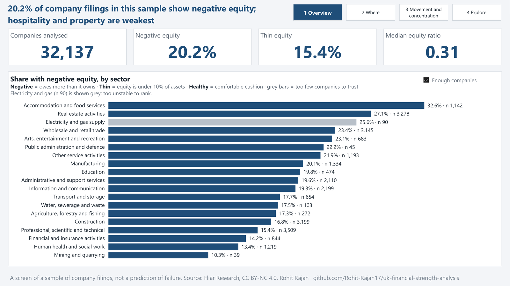
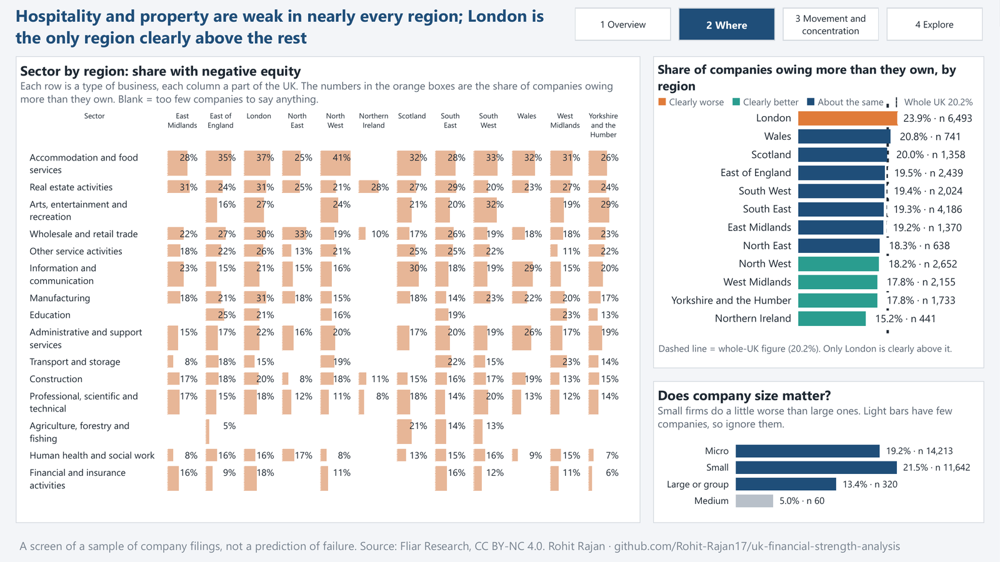
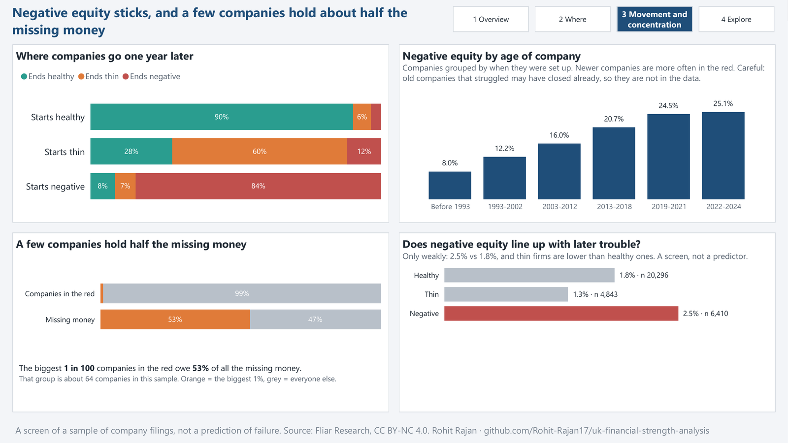
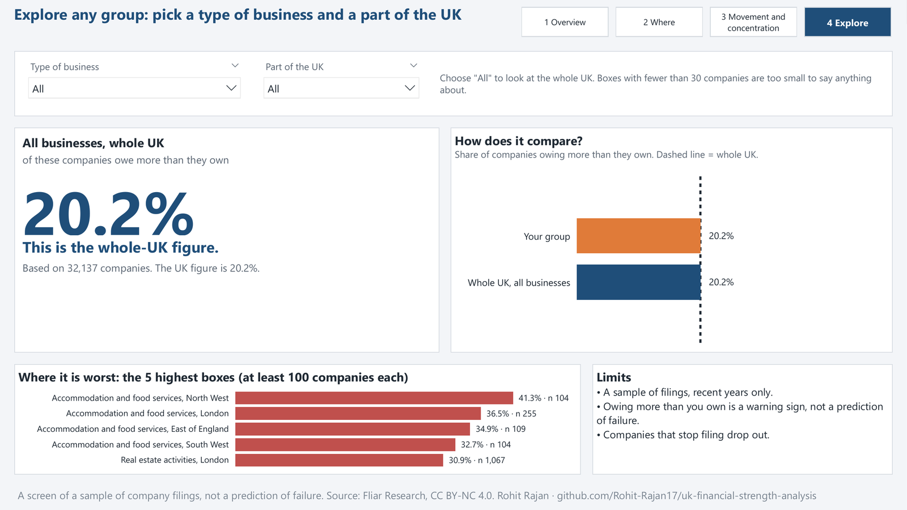

# UK company financial strength screen

**Which UK sectors, regions and types of company have the thinnest balance sheets, how often do companies fall into negative equity from one year to the next, and how much of that can the data actually support?**

An entry-level data analysis project on a public sample of UK company accounts (Companies House filings). Built with PostgreSQL, Excel and Power BI. It is a first-pass screen of the kind a lender or credit analyst might run, not a model of company failure.

> Author: Rohit Rajan · [LinkedIn](https://www.linkedin.com/in/rohit-rajan17) · Data: Fliar Research, UK company financials 2019 to 2025 (3% sample), CC BY-NC 4.0.

## Headline results

All figures are FY2024 unless stated. The main population is **32,137 companies** that report both equity and total assets in GBP, excluding dormant accounts.

- **20.2% have negative equity** (they owe more than they own) and **15.4% are thin** (equity under 10% of assets). On the broader basis of every company that reports equity (44,850), the share is **17.7%**, which matches the publisher's full-data figure of 17.8%.
- **Sector matters more than region.** Accommodation and food (32.6%) and real estate (27.1%) are the weakest large sectors. Accommodation and food is in the top 3 sectors in all 11 regions where it has enough companies; real estate in 9 of 12.
- **London is the only region clearly above the UK average** at 23.9% (95% interval 22.9% to 25.0%), and clearly above every other region except Wales, whose interval is wide. The other regions overlap too much to rank.
- **The pattern is not chance.** Of 147 sector-and-region groups with at least 30 companies, 21 are clearly above the average and 22 clearly below, against about 3 or 4 each that chance alone would produce.
- **Negative equity sticks.** 84% of companies with negative equity were still negative a year later. 3.4% of healthy companies and 11.6% of thin ones fell into negative equity (32,841 year-to-year pairs).
- **Younger companies are weaker:** 8.0% negative for companies set up before 1993, about 25% for those set up since 2019. The gap holds inside all 15 sectors tested, so it is not just sector mix.
- **A few companies hold most of the missing money.** The largest 1% of negative-equity companies account for about half of the total deficit (51.5% to 53.3% under four different data-quality rules).
- **It is a weak warning sign, not a predictor.** Negative-equity companies reached an adverse register status (strike-off, liquidation, administration) 2.5% of the time, against 1.8% for healthy ones. Most were unaffected.

## How it works

1. **Load and profile** the 100,000-row sample as text, then type it into a staging table with keys and CHECK rules. No rows were rejected.
2. **Log data quality:** 19 checks (non-GBP rows, dormant accounts, missing assets, equity above assets and more), kept in a table.
3. **Clean and model:** a cleaning view (name tidying with regex, size classes, flags), then a star schema with five dimensions and a fact table, primary and foreign keys, and an index test with `EXPLAIN ANALYZE`.
4. **Analyse:** snapshots by sector, region, size and sector × region; ranking within region; year-to-year transitions with `LAG`; cohorts by incorporation year; a running-total concentration curve.
5. **Test the results:** Wilson 95% intervals, a 3 × 3 sensitivity grid (thin cut-off × population), a validity test against later register status, and a benchmark against the publisher's full-data figures.
6. **Verify:** reruns on a broader population, data-quality reruns and 14 reconciliation checks across tables.
7. **Report:** a four-page Power BI report and an Excel workbook that recomputes and reconciles the SQL results with formulas.

## Report pages

| | |
|---|---|
|  |  |
|  |  |

## Repository

| Folder | What is in it |
|---|---|
| `sql/` | 26 numbered SQL scripts, run in order. Each lists the results it should return |
| `docs/VERIFICATION_LOG.md` | Every check, what it found and what changed as a result |
| `docs/DATA_DICTIONARY.md` | Tables, definitions and the population rules |
| `screenshots/` | The four Power BI report pages |
| `excel/` | Public copy of the reconciliation workbook: 18 summary tabs, 2,531 formulas, 315 checks all reading OK |

Not in this repository: the raw CSV (the licence and the publisher's terms) and the Power BI file. The full workbook (22 tabs, 16,047 formulas, 27 of 27 reconciliation checks matching) is kept locally because it holds company-level rows and company names. In the public copy those tabs are removed, and the cells that counted them are stored as values (blue text).

## How the numbers were checked

- All 26 scripts were run end to end from the raw CSV, and the 14 reconciliation checks in `15e` all agree (for example, 32,137 rows and £656,922,621,948 of assets in both the clean view and the fact table).
- The Excel workbook recomputes the SQL results with `SUMIFS`, `COUNTIFS` and `INDEX`/`MATCH`: 27 of 27 checks match.
- Every figure in the Power BI report matches the SQL results tables.
- The sample reproduces the publisher's full-data FY2024 figures: overall 17.7% vs 17.8%, London 20.1% vs 20.0%, real estate 24.1% vs 24.1%, finance 13.7% vs 14.0%. All six published figures tested fall inside the sample's 95% intervals.

## Limits

- **Company accounts, not bank or insurer data.** The lender's-view framing is an analogy.
- **A 3% sample** (100,000 company-years). Small groups are noisy, so groups under 30 companies are not ranked, and the 147-group comparison is not adjusted for multiple testing.
- **Effectively FY2023 to FY2025.** Earlier years have almost no rows, so no long-term trend is claimed. Transitions rest on two year-steps, and FY2025 may be partly filed.
- **Survivorship.** Companies that stop filing drop out, so transition and cohort results flatter survivors.
- **Register details are a May 2026 snapshot**, not the year of the accounts: status, sector, region and size class. Region is the registered office, not where a company operates.
- **11,880 FY2024 rows report equity but no assets**, so they are outside the main population. That is why two bases are reported (17.7% and 20.2%).
- **The thin cut-off (10%) is a judgement call.** The thin share moves from 10.7% to 19.5% across the sensitivity grid, while the negative-equity findings stay stable.
- **Negative equity is not insolvency.** Many companies with negative equity are subsidiaries funded by a parent.

## Data and licence

Fliar Research (2026), *UK Company Financials 2019–2025*, sample release, built from Companies House annual accounts. Licence: [CC BY-NC 4.0](https://creativecommons.org/licenses/by-nc/4.0/). Download: [Kaggle](https://www.kaggle.com/datasets/harshitkz/uk-company-financials-2019-2025).

To reproduce: create a Postgres database, then either run `sql/01_load_raw_and_profile.sql` in psql with the CSV in `data/`, or run `01a`, import the CSV with your database tool, and run `01b`. Then run the remaining scripts in number order.

## Tools

PostgreSQL and DBeaver (CTEs, window functions: `RANK`, `ROW_NUMBER`, `LAG`, running `SUM`; `percentile_cont`; `FILTER`; regex; views; primary, foreign and CHECK constraints; `generate_series`; `EXPLAIN ANALYZE`), Excel (`SUMIFS`, `COUNTIFS`, `INDEX`/`MATCH`, Wilson intervals as formulas), Power BI Desktop (DAX measures, slicers, a sector-and-region explorer).
